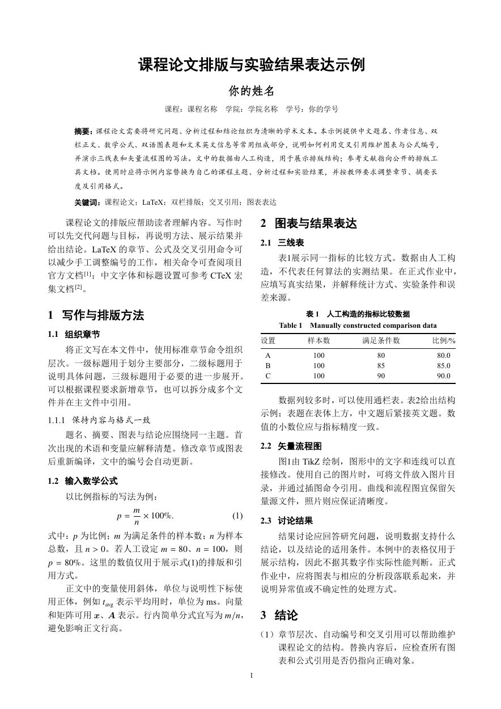

# 郑州大学学报（工学版）LaTeX 模板

ZZU Journal LaTeX Template · 非官方课程论文与排版学习模板

这份**郑大学报 LaTeX 模板**参考《郑州大学学报（工学版）》稿件版式，面向希望使用郑大工学学报版式撰写课程论文、课程报告的同学。工程使用 **XeLaTeX** 编译，提供中文首页、双栏正文、数学公式、三线表、双语图表题、参考文献和文末英文摘要。

本项目为非官方的独立实现。课程作业以教师要求为准；用于投稿前，请核对期刊最新要求与生成的 PDF。

[使用此模板](https://github.com/yis2014/zzu-journal-latex/generate) · [下载源码 ZIP](https://github.com/yis2014/zzu-journal-latex/archive/refs/heads/main.zip) · [查看完整 PDF](docs/preview.pdf) · [反馈问题](https://github.com/yis2014/zzu-journal-latex/issues)



## 快速开始

1. 点击 [Use this template](https://github.com/yis2014/zzu-journal-latex/generate) 创建自己的仓库，或[下载并解压源码 ZIP](https://github.com/yis2014/zzu-journal-latex/archive/refs/heads/main.zip)。
2. 在 `main.tex` 中填写题名、姓名、课程、学院、学号、中英文摘要和关键词。
3. 将 `sections/example.tex`、`references.tex` 和 `images/` 中的教学示例替换为自己的正文、真实数据、参考文献及图片。
4. 用 **XeLaTeX** 编译并检查 `main.pdf`。提交作业前，检查姓名学号、示例占位内容、图表编号和分页。

示例表格中的数字由人工构造，仅用于演示排版，不是实测结果。

### 本地编译

安装包含中文支持的 TeX Live，或安装相应宏包的 MiKTeX，在工程目录运行：

```sh
latexmk -xelatex -interaction=nonstopmode -halt-on-error main.tex
```

没有 `latexmk` 时，连续运行两遍，更新交叉引用和文献编号：

```sh
xelatex -interaction=nonstopmode -halt-on-error main.tex
xelatex -interaction=nonstopmode -halt-on-error main.tex
```

Windows 用户也可以在 PowerShell 运行：

```powershell
./build.ps1
```

输出文件为 `main.pdf`。本仓库示例已在本地 **TeX Live 2026** 中完成默认字体和回退字体编译检查，具体记录见 [构建核验记录](docs/release-verification.json)。

### Overleaf 使用方式

在 Overleaf 新建项目并上传整个源码 ZIP，确认主文档为 `main.tex`，在项目设置中将编译器设为 **XeLaTeX**，然后编译。请保留 `sections/`、`images/` 等目录层级。

工程在 Windows 字体不可用时会使用 Fandol 中文字体和 TeX Gyre Termes 等回退字体，字体随 TeX 发行版提供。**目前核验范围为本地 TeX Live 2026，尚未在 Overleaf 实测**；不同字体与环境可能产生不同的断行和分页。

## 工程结构

| 文件 | 用途 |
| --- | --- |
| [`main.tex`](main.tex) | 主文档；中英文题名、作者、课程、学号、摘要和关键词 |
| [`sections/example.tex`](sections/example.tex) | 正文示例；章节、公式、单栏表和通栏表 |
| [`references.tex`](references.tex) | `thebibliography` 参考文献示例 |
| [`images/workflow.tikz`](images/workflow.tikz) | 可编辑的 TikZ 矢量流程图 |
| [`zzueng.cls`](zzueng.cls) | 字体、页边距、行距、双栏、图表题等版式定义 |
| [`build.ps1`](build.ps1) / [`latexmkrc`](latexmkrc) | 编译脚本和配置 |
| [`docs/preview.pdf`](docs/preview.pdf) | 由当前教学示例生成的完整预览 |
| [`docs/sources.md`](docs/sources.md) | 版式来源、核验日期和原附件 SHA-256 |

## 常用修改

### 课程模式与首页信息

默认主文档使用课程模式：

```latex
\documentclass[coursework]{zzueng}

\zzutitle{你的课程论文题目}
\zzuauthor{你的姓名}
\zzuaffiliation{课程：课程名称\quad 学院：学院名称\quad 学号：你的学号}
\zzuarticleid{} % 可选课程编号，留空不显示
\zzuabstract{填写中文摘要。}
\zzukeywords{关键词一；关键词二；关键词三}
```

`coursework` 隐藏中图分类号、文献标志码等课程作业通常不需要的期刊字段。去掉该选项后，类文件提供文章编号等期刊字段的排版接口；这不表示稿件已符合期刊投稿要求。

### 章节、公式与图表引用

| 需要做什么 | 命令示例 |
| --- | --- |
| 分级标题 | `\section{方法}`、`\subsection{实验设置}`、`\subsubsection{参数}` |
| 双语图表题 | `\zzucaption{中文题名}{English title}` |
| 标记并引用图表 | 题名后写 `\label{fig:demo}`，正文写 `图\ref{fig:demo}` |
| 引用公式 | 在公式环境内写 `\label{eq:demo}`，正文写 `式\eqref{eq:demo}` |
| 引用参考文献 | `\cite{latex-doc}`，键名对应 `references.tex` 中的 `\bibitem` |
| 通栏图表 | 使用 `figure*` 或 `table*` 环境 |

`\zzucaption` 放在 `figure` 或 `table` 环境内，自动生成中文编号和英文题名。添加或删除图表、公式、文献后，请重新编译以更新编号。示例使用手工文献列表；替换文献时应核对作者、题名、年份和来源。

### 文末英文信息

在 `main.tex` 中修改 `\zzuentitle`、`\zzuenauthor`、`\zzuenaffiliation`、`\zzuenabstract` 和 `\zzuenkeywords`，主文档末尾的 `\makeenglishabstract` 会输出英文信息。

- 不需要英文信息时，删除 `\makeenglishabstract`。
- 没有浮动图表时，英文信息按剩余空间通栏衔接或换页。
- 使用浮动图表时，先排完正文与图表，再另页输出英文信息，避免浮动图表与通栏块重叠。
- 希望始终从独立末页开始时，使用 `\makeenglishabstract*`。

## 常见问题

**为什么 pdfLaTeX 编译报错？**

类文件使用 `fontspec` 和中文字体设置，需要 XeLaTeX。请检查编辑器或在线项目的编译器设置。

**缺少宏包或字体怎么办？**

优先使用较完整的 TeX 发行版，并根据日志安装缺少的宏包。不要把来源不明的字体文件放入仓库；本工程会检测常见 Windows 字体，并在缺失时切换回退字体。

**能直接用于课程作业或期刊投稿吗？**

可以将工程用于自己的写作与排版。提交课程作业时，应替换示例并遵守课程要求。期刊投稿需自行核对最新作者指南；Word 与 XeLaTeX 的字体度量、断行和分页可能不同。

## 版式来源与许可

版式主要参考期刊官网的[稿件模板入口](http://gxb.zzu.edu.cn/Corp/5031.aspx)，并对照了官方论文样例。来源链接、版式依据及校验值见 [来源记录](docs/sources.md)。仓库只保留独立实现的排版代码和新编教学示例，不附带官方 Word 文件、期刊论文原文或字体文件。

自主编写的代码、脚本、文档和原创课程示例采用 [MIT License](LICENSE)，使用、修改和分发时请保留版权及许可证说明。期刊名称与标识、官方附件、系统字体和外部 TeX 宏包不属于本项目重新授权的内容，具体范围见 [NOTICE.md](NOTICE.md)。

欢迎通过 [Issues](https://github.com/yis2014/zzu-journal-latex/issues) 或 Pull Request 改进模板。反馈排版问题时，请提供编译器与 TeX 版本、相关日志和最小复现示例，操作说明见 [CONTRIBUTING.md](CONTRIBUTING.md)。维护流程见 [维护与发布指南](docs/github-publishing.md)。

## English overview

**ZZU Journal LaTeX Template** is an unofficial XeLaTeX project inspired by the manuscript layout of the *Journal of Zhengzhou University (Engineering Science)*. It is intended for course reports and learning academic typesetting, with a Chinese title block, two-column text, equations, bilingual captions, references, and English end matter.

[Use this template](https://github.com/yis2014/zzu-journal-latex/generate) or [download the source ZIP](https://github.com/yis2014/zzu-journal-latex/archive/refs/heads/main.zip), edit `main.tex` and `sections/example.tex`, then run `latexmk -xelatex main.tex`. Local validation used TeX Live 2026; Overleaf has not been tested. The project is independently maintained and is not endorsed by the journal or Zhengzhou University. Original project code and examples are available under the [MIT License](LICENSE); see [NOTICE.md](NOTICE.md) for third-party boundaries.
